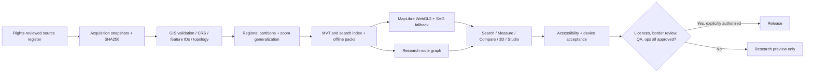

# Bharat Atlas — End-to-end engineering program

**Revision:** 2026-10-25 | **Current research branch:** v0.36 integrated foundation | **Release approval:** NO.  
**Operating principle:** One evolving, source-controlled application and data pipeline; parallel engineering workstreams and unified acceptance. Do not release a separate cosmetic build after each feature. All claimed map features must have source-backed proof.

## 1. Product definition and completion criteria

Build a mobile-first interactive India atlas with accurate source-labelled physical geography; reviewed political and administrative representations; cities, towns, villages, roads, railways, hydrography and POIs; bilingual search; offline regional maps; map measurement and export; research-grade temporal layers; fast camera navigation; and navigation only when a certified routable graph is available. Nothing in this roadmap promises commercial Google Maps parity without the data, infrastructure, budget and field verification that would require.

**Done** means functioning, representative real map content; valid licences; source provenance; UX accessibility; unmocked GPU and real mobile evidence; geographically sampled visual QA; security and performance audits; repeatable builds; operational monitoring and rollback. Passing unit tests alone is never equivalent.

## 2. Unified architecture



Data lineage, attribution, manifest integrity and missing-data state must remain visible throughout the pipeline. Political claims and actual administration must be modelled separately where appropriate, never automatically merged into a single 'official' polygon.

## 3. Complete feature and engineering matrix

| Workstream | Functional end-state | Built before this iteration | Integrated in v0.36 | Missing exit conditions |
|---|---|---|---|---|
| Geographic sources and rights | Reviewed, repeatable data provenance, licence registry and audit trail | GSHHG/WDBII physical data, Natural Earth selected places, metadata templates | Single readiness surface; auditable roadmap and test runner | Legal permissions for official Indian political vectors; current OSM/other dataset acquisition, source-specific terms |
| National basemap | Zoom 3–18 vector land, roads, rail, named water, settlement/POI labels | 608 sparse zoom 3–8 tiles and optional pack importer | Zoom occupancy reported explicitly | Real nationwide data, generalization, multi-scale labels, correctness and visual QA |
| Territory/cartography | SOI-referenced, editioned political/admin layers; island/northern QA | Candidate import and GIS topology gates | Public-release blocker retained | Licensed reference vectors, claim/control distinction, Shaksgam and disputed-region review, signed human GIS QA |
| Rendering and motion | WebGL2 MapLibre, validated device render, adaptive effects | Camera easing, SVG fallback, simulated interaction and recovery | Offline cache revision and source-readiness UX | Authentic MapLibre assets in preview, GPU proof, Android/iOS evidence, frame/jank/performance tuning |
| Search/geocoder | Bilingual name, aliases, villages, addresses, POIs, crosswalks | 71 Natural Earth places and pilot search | Missing dataset indicated honestly | Full place index, offline partitioned geocoder, address hierarchy, relevance/dedup QA |
| Navigation | Validated road graph with snapping, restrictions and route choices | Research-only shortest path over supplied vertices | False road-junction risk fixed by exact coordinate node identity | Intersection geometry, elevation/access/turn restrictions, speed/traffic, real-world validation |
| Atlas Labs and education | Verified comparisons, time maps, worksheets, mapping studio | Research modules for study, temporal layers, stories, exports | Roadmap contract unifies these | Educator review, curated dated data, reliable narrative provenance, proper PDF/print quality |
| Offline/local | Regional downloadable packs and shell, bounded storage | Browser cache and SVG fallback | Versioned cache and conservative handling of unknown-length HTTP bodies | Regional pack lifecycle, quota, signed manifest updates, real offline-device tests |
| Security/quality | Non-bypassable data gates, CI, A11y, load, monitoring | SHA-256 static assets, release guard, synthetic test suites | One-command audit, stronger routing tests, readiness JSON | Threat model, SAST/DAST, WCAG, 1,000-user test, operations and incident-response evidence |
| UX and accessibility | Responsive, fast, legible labels and low-motion mode | Responsive panels, journeys, keyboard fallback, reduced motion | Status grouped under existing Coverage tab rather than crowding map | Physical-device usability, Hindi typography, screen reader verification, expert cartographic review |

### 3.1 Data source rules

* **Physical/historical:** GSHHG/WDBII material in current package has generalized historical geometry. Never present it as modern named rivers, street-level data or political authority.
* **Places:** Natural Earth selected points are source-labelled, coarse-scale; not a complete Indian city/town/village index.
* **Modern transport and POIs:** Acquire a documented regional OSM extract first from Geofabrik or another compliant supplier. Store acquisition date, original SHA, ODbL/attribution assessment, import script version, coverage limitations and any permitted redistribution notices. India-wide `.osm.pbf` is large and needs a partitioned, memory-bounded ingestion program.
* **Political geometry:** Survey of India 2026 English 13th-edition political map is an official visual reference, **not automatically a redistributable vector license**. Verify the specific digital product, machine-readable edition, permitted derivative use, and territory/control distinction with independent reviewers.
* **Never** substitute made-up geometry, names, user-uploaded data, or synthetic fixtures for actual production datasets.

## 4. Workstreams executed in parallel (not one-feature releases)

**Track A — Verified data supply:** license inventory -> regional acquisition -> provenance and CRS checks -> feature classification -> partitioned vector tiles -> missing-cell and source-age reporting -> nationwide expansion. Keep production source archives separate from synthetic test fixtures.

**Track B — Real renderer and design:** pin authentic MapLibre distribution, self-host assets, confirm WebGL2/canvas/decoded features -> optimize pan/zoom/label collisions and gesture navigation -> real device proof -> accessible SVG fallback and reduced motion. Do not infer successful GPU rendering from a mock.

**Track C — Search and geocoding:** searchable source IDs and bilingual aliases -> village/town hierarchy -> reverse geocoder -> district and address indexing -> relevance/ambiguity evaluation. Location search cannot infer legal territory from a nonauthoritative point.

**Track D — Routing:** build routable topology using supplied roads and true crossings, distinguish grade-separated segments, map-matched endpoints, turn restrictions, bridge/tunnel/access and road classes; evaluate route error against independent test trips before enabling travel instructions. Exact shared vertices alone are still insufficient for navigation.

**Track E — Studio, learning and spatial analytics:** cartography themes, legends, scale/north notes, advanced layer controls, 4K/8K and A3/A2 print, source-backed timed layers, reviewable story maps, district statistics and classroom tools. Include honest map projection/scale limitations.

**Track F — Production and operations:** automated reproducible builds, provenance manifests, security/accessibility/device tests, monitoring, traffic/load testing, offline quota/updates, backup/rollback and release signoff. Production promotion must stay blocked until all release gates are satisfied and authorized.

Tracks may proceed in parallel, but the final release is a **single integrated acceptance gate**.

## 5. Engineering completion gates

1. **Geography gate:** audited source provenance for each layer, legal redistribution review, official political reference and disputed-territory human QA, documented uncertainty. No fake India-claim polygons.
2. **Basemap gate:** real roads, railways, named rivers and dense settlement/POI data in representative regions, then India-wide coverage; correct zoom/label behavior and tile size budgets.
3. **Renderer gate:** locally bundled, cryptographically pinned MapLibre; unmocked WebGL2 physical GPU proof with decoded local MVT features, pan/zoom, acceptable label rendering, and Android/iOS browser evidence.
4. **Search/routing gate:** substantial bilingual query benchmark, non-road/exact coordinate handling, source integrity, and independently validated route connectivity, access restrictions and fail-closed behavior.
5. **Experience gate:** actual device/screenreader/keyboard tests; map motion, low-memory behavior, reduced-motion modes, accurate exports and representative map screenshots.
6. **Operations gate:** measured concurrent-load target, CDN/cache behavior, monitoring, threat model, recoverability, rollback and compliance.
7. **Approval gate:** independent data/release reviewer plus user's explicit deployment permission. All earlier code releases remain local research candidates.

## 6. Data and repository layout

```text
src/                       map UI, search, rendering, atlas tools
scripts/                   source preparation, tile build, geographic QA and one-command audit
data/                       reviewed local research data and tile manifests
source-data/                pinned raw extracts and licences
vendor/                     authenticated MapLibre assets only
proof/                      unmocked renderer proof
screenshots/ or docs/        reviewed device/GIS evidence (never fabricated)
dist/                       generated static preview, never manual-edit
MASTER_ROADMAP_AND_ENGINEERING_SPEC.md
```

Optional feature packs install under `data/transport-pack/`, never overwrite physical or political sources. Every source dataset should declare publisher, URL, rights basis, snapshot date, SHA-256, bounding box, CRS, feature counts and known exclusions.

## 7. Commands (Windows full-source folder)

```powershell
py -3 -m pip install -r requirements-geo.txt
py -3 scripts\atlas_program.py --run-tests --output docs\PROGRAM_AUDIT_LOCAL.json
py -3 -m http.server 8000 --directory dist --bind 127.0.0.1
```

`atlas_program.py` runs all Node and Python unit tests, produces a deterministic local build, verifies the asset manifest, confirms the production guard rejects release, and writes a local report; **it does not obtain external datasets, pass unmocked WebGL or deploy anything**. The report should not be shared publicly without review.

## 8. Recorded release risk register

| Severity | Risk | Mitigation / owner type |
|---|---|---|
| Critical | Geographic claims, administrative edition differences, licensed derivative rights | Human cartographer and legal/data-rights reviewer |
| Critical | Real MapLibre renderer unavailable / software fallback | GPU desktop + actual phone acceptance and pinned vendored runtime |
| Critical | Missing modern nationwide geometry and POI index | Data acquisition and GIS processing lead; regional proof before nationwide rollout |
| High | Routing false connections at near-identical coordinates | Exact source vertices in v0.36; full grade-separated topology before navigation |
| High | Stale cached frontend when upgrading research preview | Versioned service-worker cache in v0.36; explicit update/offline tests still due |
| High | Misleading zoom counts | Declared occupancy clearly different from actual feature coverage and authority |
| High | Large OSM import resource exhaustion | Regional extraction, bounds, geometry limits, streaming pipeline and partitioning |
| Medium | Mobile map clutter and animation discomfort | Separate tool tabs, reduced-motion, tested control and label density |

## 9. Actual v0.36 implementation outcome

Implemented in the consolidated code: road-graph junction safety fix; versioned offline cache and no unknown-length runtime caching; integrated data-readiness and per-zoom inventory in the Coverage tab; downloadable local-only readiness report; unified full-source audit command and regression tests. All inherited research features remain. We still do not possess source-cleared national transport data, certified political vectors, an authentic MapLibre runtime or real-device proof here; therefore an honest end-to-end result is a **locally integrated research codebase with major external dependencies**, not a complete released navigation platform.

**No automatic background work or deployment is implied by this roadmap.** Additional work happens when the project is resumed in a future conversation or executed by a separate, explicitly configured agent/build system.


## 10. v0.37 cross-track implementation update

The integrated repository adds audited MVT cell-level feature counts, independent per-layer tile inventory verification, exact layer-count presentation at inspected tile coordinates, a regional source-to-MVT pack command, and bounded place-manifest reading. These complete engineering **infrastructure** milestones, not the data-acquisition/GPU/legal sign-off gates. Full detail and commands: `V37_INTEGRATED_DEVELOPMENT_REPORT.md`.